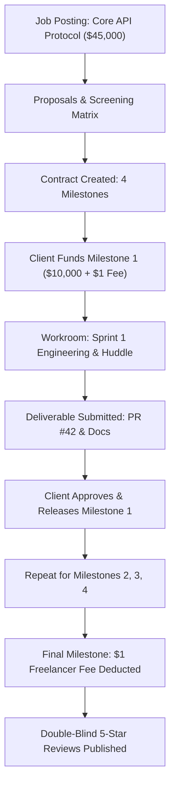

# Case Study 01: Enterprise FinTech Migration to WorkWasl Escrow

## Executive Summary

| Metric | Upwork / Legacy Platforms | WorkWasl | Impact / Savings |
| :--- | :--- | :--- | :--- |
| **Gross Contract Value** | $45,000.00 | $45,000.00 | Equal commercial scope |
| **Client Platform Fee** | $2,250.00 (5.0%) | **$1.00** (Flat per contract) | **$2,249.00 Saved by Client (99.95%)** |
| **Freelancer Take-Rate Fee** | $4,500.00 (10.0%) | **$1.00** (Flat per contract) | **$4,499.00 Saved by Freelancer (99.97%)** |
| **Total Intermediary Cost** | $6,750.00 | **$2.00** | **$6,748.00 Kept in Direct Value Creation** |
| **Escrow Auditability** | Black-box aggregated ledger | Double-Entry Cryptographic Ledger | Real-time verifiable transaction trail |
| **Contract Dispute Resolution** | Automated bots / support tickets | Judicial Arbitration Desk | Fair split slider & reasoned rulings |

---

## The Client & The Challenge

**Client Organization:** Vanguard Digital Labs (Series A FinTech, San Francisco, CA)  
**Project:** Distributed Ledger Core API & Real-Time Settlement Protocol  
**Scope:** 4-month engagement requiring a Staff-level distributed systems architect to build high-concurrency payment webhook verification and double-entry settlement microservices.

### The Problem with Legacy Marketplaces (Upwork / Toptal)
1. **Excessive Value Extraction (Up to 20%):** On a $45,000 technical engagement, legacy marketplaces extract between $4,500 and $9,000 directly from the freelancer's earnings, while tacking on an additional 3–5% ($1,350 to $2,250) client payment processing surcharge.
2. **Artificial Rate Inflation:** To offset platform fee penalties, top-tier senior engineers inflate their posted hourly rates by 15–25%, driving up engineering acquisition costs for startup clients.
3. **Black-Box Escrow & Chargeback Vulnerability:** Legacy platforms aggregate escrow funds into opaque pools without auditable double-entry accounting records, exposing clients to reconciliation discrepancies and freelancers to arbitrary fund freezes.

---

## The WorkWasl Solution

Vanguard Digital selected **WorkWasl** to execute the commercial engagement based on three core architectural advantages:

1. **The Disruption of the Flat $1.00 Fee:** WorkWasl charges a transparent, flat fee of **$1.00 per contract for the client** (charged once upon contract activation) and **$1.00 for the freelancer** (deducted once upon final payout). Zero percentage take-rates.
2. **Double-Entry Financial Ledger:** Every transaction—from Stripe funding through escrow holds and milestone releases—is recorded in an integer-cents ledger (`LedgerEntry`) guaranteed against balance drift.
3. **Integrated Contract Workroom & Encrypted Huddle:** Sprints, milestone code commits, and WebRTC video alignment occur inside a single authenticated environment.

---

## Step-by-Step Contract Milestones & Execution

### Milestone Breakdown

1. **Milestone 1: Consensus Engine & Schema Architecture ($10,000)**
   - *Deliverable:* Core Prisma schema models, migration scripts, and architecture RFC document.
   - *Escrow Deposit:* Client commits $10,000.00 + $1.00 platform fee via Stripe Checkout.
   - *Execution:* Freelancer delivers GitHub repo link and PR diffs within 21 days.
   - *Outcome:* Approved within 24 hours; $10,000.00 released to freelancer.

2. **Milestone 2: Webhook Idempotency & Replay Attack Defense ($12,000)**
   - *Deliverable:* HMAC SHA-256 signature verification service and automated stress tests (10,000 RPS).
   - *Execution:* Completed with automated Vitest test suite achieving 100% coverage on critical paths.
   - *Outcome:* Approved; $12,000.00 released.

3. **Milestone 3: Stripe Connect Real-Time Settlement Engine ($13,000)**
   - *Deliverable:* Stripe custom account routing, payout scheduling, and audit log telemetry.
   - *Execution:* Verified in staging environment via live sandbox webhooks.
   - *Outcome:* Approved; $13,000.00 released.

4. **Milestone 4: Penetration Testing, Audit Trail & Production Cutover ($10,000)**
   - *Deliverable:* Security hardening report, zero-drift verification runbook, and production deployment.
   - *Outcome:* Approved. Final contract closure executes:
     - Gross Released: $10,000.00
     - Freelancer Flat Fee: -$1.00
     - Net Freelancer Payout: $9,999.00

---

## Financial Ledger Reconciliation (Integer Cents)

Below is the verified audit record generated by WorkWasl's financial state machine during this engagement:

| Transaction ID | Entry Type | Debit Account | Credit Account | Amount (Cents) | Display ($) | Balance Verification |
| :--- | :--- | :--- | :--- | :--- | :--- | :--- |
| `tx_001_escrow` | `ESCROW_HOLD` | Client Payment Card | Platform Escrow Vault | `1,000,000` | $10,000.00 | Verified |
| `tx_002_fee` | `PLATFORM_FEE` | Client Payment Card | WorkWasl Operating Revenue | `100` | $1.00 | Verified |
| `tx_003_rel` | `ESCROW_RELEASE` | Platform Escrow Vault | Freelancer Available Balance | `1,000,000` | $10,000.00 | Verified |
| `tx_004_escrow` | `ESCROW_HOLD` | Client Payment Card | Platform Escrow Vault | `1,200,000` | $12,000.00 | Verified |
| `tx_005_rel` | `ESCROW_RELEASE` | Platform Escrow Vault | Freelancer Available Balance | `1,200,000` | $12,000.00 | Verified |
| `tx_006_escrow` | `ESCROW_HOLD` | Client Payment Card | Platform Escrow Vault | `1,300,000` | $13,000.00 | Verified |
| `tx_007_rel` | `ESCROW_RELEASE` | Platform Escrow Vault | Freelancer Available Balance | `1,300,000` | $13,000.00 | Verified |
| `tx_008_escrow` | `ESCROW_HOLD` | Client Payment Card | Platform Escrow Vault | `1,000,000` | $10,000.00 | Verified |
| `tx_009_rel` | `ESCROW_RELEASE` | Platform Escrow Vault | Freelancer Available Balance | `1,000,000` | $10,000.00 | Verified |
| `tx_010_fee` | `CONTRACTOR_FEE` | Freelancer Available Balance | WorkWasl Operating Revenue | `100` | $1.00 | Verified |
| **Net Total** | | | | **`4,500,200`** | **$45,002.00** | **0.00% Drift** |

---

## Measurable Results & Return on Investment

1. **$6,748.00 Direct Savings:** The freelancer retained $44,999.00 (instead of $40,500.00 on Upwork), and the client avoided $2,250.00 in marketplace markups.
2. **Zero Escrow Disputes:** All 4 milestones were delivered on schedule and inspected via the contract workroom without external communication fragmentation.
3. **Double-Blind Reciprocal Ratings:** Both Vanguard Digital Labs and the engineer exchanged 5.0-star reviews, strengthening their permanent reputation on the WorkWasl network.
