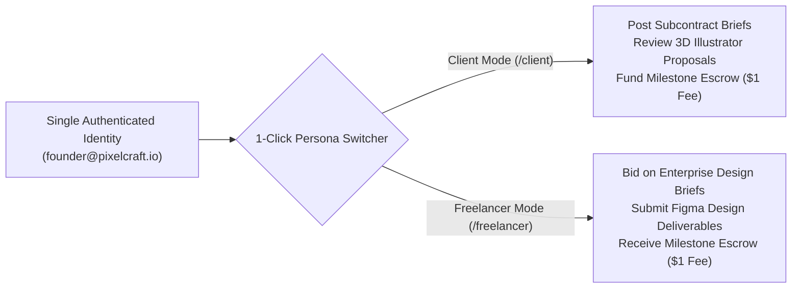

# Case Study 03: Scaling a Boutique Studio with Unified Dual-Persona Architecture

## Executive Summary

| Parameter | Legacy Platforms (Upwork / Fiverr) | WorkWasl Dual-Persona Architecture |
| :--- | :--- | :--- |
| **Account Overhead** | 2 separate logins (Client account + Agency profile) | **1 unified authenticated identity with 1-click switcher** |
| **Tax & Financial Reporting** | Disjointed 1099s & credit balances across multiple logins | **Unified double-entry balance ledger and reporting** |
| **Platform Commission on Subcontracting** | 10% paid as Agency + 5% paid as Client ($1,500 on $10k) | **$1 Client Fee + $1 Freelancer Fee ($2 total)** |
| **Team Context Switching Time** | ~45 minutes per day relogging and managing silos | **Instantaneous mode switching via top navigation pill** |

---

## The Studio & The Operational Challenge

**Organization:** PixelCraft Labs (Design Studio, Austin, TX)  
**Model:** Hybrid agency delivering high-end enterprise design systems ($15,000–$30,000 contracts) while subcontracting 3D motion designers and icon illustrators for specific milestone deliverables.

### The Problem with Platform Fragmentation
On legacy freelance platforms, agency operators face an artificial barrier:
1. **The "Two-Account" Penalty:** Platforms force operators to register a distinct "Client" account to hire subcontractors, while maintaining an "Agency Freelancer" profile to bid on client work.
2. **Account Switching Friction:** Team leads constantly log out and log back in, juggle multiple 2FA authenticators, and lose notification context when switching between hiring and earning.
3. **Double Platform Taxation:** When PixelCraft wins a $20,000 contract on Upwork, the platform takes $2,000 (10%). When PixelCraft then subcontracts $5,000 of that scope to a specialist 3D illustrator on the same platform, the platform takes another 10% ($500) plus 5% ($250) client fee. The agency loses $2,750 on a single engagement.

---

## The WorkWasl Solution: Unified Dual-Persona System

WorkWasl was engineered from day one around **Unified Dual-Persona Architecture** ([`src/components/layout/persona-switcher.tsx`](file:///d:/mywork/xcs-job-portal/src/components/layout/persona-switcher.tsx)):

### Key Technical Capabilities
1. **Dynamic Session RBAC:** The session holds both `CLIENT` and `FREELANCER` roles in an array (`roles: ["CLIENT", "FREELANCER"]`). Navigation items, top-level menus, and contextual actions dynamically adapt based on the active path (`/client` vs `/freelancer`).
2. **Contextual Action Alert Banner:** When PixelCraft operates in Client mode, they receive alerts about submitted deliverables from their subcontractors. When they switch to Freelancer mode, they see review feedback from their enterprise clients.
3. **Flat $1 Fee Multiplier:** By paying only $1 to hire and $1 to deliver, PixelCraft eliminates thousands of dollars in intermediary fee friction on every project.

---

## Real-World Workflow: The "Fintech Mobile App" Project

### Phase 1: Winning the Enterprise Brief (Freelancer Mode)
- PixelCraft navigates to `/jobs` and discovers an open listing: *"Design System & Mobile App UI for NeoBank ($22,000)"*.
- In Freelancer mode, PixelCraft submits a detailed milestone proposal with their verified portfolio case studies and team credentials.
- The client awards the contract.
- PixelCraft delivers Milestone 1 (Design Tokens & Typography) and Milestone 2 (Core Mobile Screens).

### Phase 2: Sourcing a 3D Icon Illustrator (Client Mode)
- For Milestone 3 (Custom 3D Animated Assets), PixelCraft needs a specialized Spline / Cinema4D artist.
- With one click on the **Persona Switcher**, PixelCraft switches to **Client Hiring Mode**.
- Posts a targeted job: *"3D Interactive Hero Assets for NeoBank ($4,000)"*.
- Uses the **Proposal Comparison Matrix** to compare 6 artist applicants.
- Hires an illustrator, funds Milestone 1 into escrow ($2,000 + $1 fee), and coordinates in the contract workroom.

### Phase 3: Final Delivery & Dual Settlement
- The 3D illustrator submits final assets; PixelCraft inspects them and releases escrow.
- PixelCraft incorporates the 3D assets into the master Figma prototype and submits the final NeoBank deliverable.
- The enterprise client approves and releases the $22,000 contract.
- Both contracts settle on the WorkWasl ledger with **$2.00 in total platform fees** across the entire pipeline.

---

## Financial Comparison on a $22,000 Project with $4,000 Subcontract

| Commercial Item | Legacy Platform (Upwork) | WorkWasl Platform |
| :--- | :--- | :--- |
| **Enterprise Client Fee** | $1,100.00 (5%) | $1.00 |
| **PixelCraft Gross Fee on $22k** | $2,200.00 (10%) | $1.00 |
| **Subcontract Client Fee ($4k)** | $200.00 (5%) | $1.00 |
| **Subcontractor Fee on $4k** | $400.00 (10%) | $1.00 |
| **Total Intermediary Fees Extracted** | **$3,900.00** | **$4.00** |
| **Studio Net Margin Retained** | **$15,800.00** | **$17,998.00 (+$2,198.00)** |

---

## Qualitative Studio Feedback

> *"WorkWasl's dual persona switcher fundamentally changes how boutique studios operate. In the morning, I review our illustrator's progress on an open milestone as a Client; in the afternoon, I present design deliverables to our Series B client as an Expert Freelancer. We saved over $2,000 in fees on a single client engagement, and our accounting is 100% cleaner."*  
> — **Creative Director, PixelCraft Labs**
