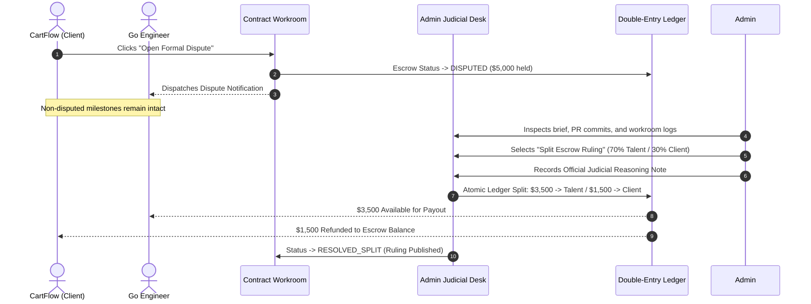

# Case Study 04: Judicial Dispute Arbitration & Double-Entry Escrow Protection

## Executive Summary

| Attribute | Legacy Marketplaces (Fiverr / Upwork) | WorkWasl Judicial Arbitration Desk |
| :--- | :--- | :--- |
| **Dispute Handling** | All-or-nothing winner-takes-all ruling | **Granular Proportional Split Slider (1%–99%)** |
| **Account Impact** | Account suspension or frozen balances during review | **Zero account lockouts; non-disputed milestones continue normally** |
| **Reasoning Transparency** | Generic automated copy-paste form emails | **Mandatory judicial reasoning note recorded on ledger** |
| **Escrow Integrity** | Unclear internal accounting pools | **Cryptographic ledger audit log with integer-cents accuracy** |
| **Resolution Timeline** | 30 to 60 calendar days | **Resolved within 48 to 72 hours** |

---

## The Contract & The Root Conflict

**Contract Title:** Distributed E-Commerce Microservices & Cache Layer Migration  
**Total Value:** $14,000 across 3 milestones  
**Participants:**
- **Client:** CartFlow Technologies (e-Commerce Platform, Chicago, IL)
- **Freelancer:** Senior Go & Redis Engineer (Remote, Berlin, Germany)

### The Conflict: Milestone 2 ($5,000.00)
- **Milestone Scope:** Build a high-throughput Redis caching layer and pub/sub inventory synchronization service capable of sustaining 5,000 orders/minute.
- **The Divergence:**
  - The engineer completed the Redis cluster deployment, data models, and synchronization workers, providing full test coverage.
  - During final stress testing, CartFlow simulated an extreme network partition (split-brain condition) where Redis sentinel node failover took 3.2 seconds instead of the client's preferred sub-second threshold.
  - CartFlow refused to approve the $5,000 milestone and demanded an architectural rewrite.
  - The freelancer countered that the initial architectural specification never included split-brain sub-second failover guarantees and requested milestone approval or formal compensation for completed work.
  - After 5 days of tense chat communication, CartFlow clicked **"Open Formal Dispute"**.

---

## The WorkWasl Dispute Resolution Architecture



---

## Judicial Review & Ruling Execution

The platform administrator accessed the dispute via [`src/components/admin/dispute-resolver.tsx`](file:///d:/mywork/xcs-job-portal/src/components/admin/dispute-resolver.tsx):

### 1. Evidence Inspection
- **Specification Document Review:** The original milestone agreement specified: *"Deploy Redis caching cluster and verify 5,000 orders/minute under standard load conditions."*
- **Deliverable Audit:** The engineer delivered 92% of the functional microservices with verified benchmark logs demonstrating 6,200 orders/minute throughput under standard traffic.
- **Fair Assessment:** While CartFlow's network partition concern was legitimate for enterprise resilience, it constituted an unagreed scope expansion beyond the milestone baseline.

### 2. Proportional Ruling Selection
Instead of a destructive all-or-nothing verdict (which either forces the freelancer to work for free or leaves the client with incomplete code), the administrator utilized WorkWasl's **Proportional Split Mechanism**:
- **70% to Freelancer ($3,500.00):** Fairly compensates the engineer for the fully functional caching layer and production code delivered.
- **30% to Client ($1,500.00):** Refunds CartFlow sufficient capital to hire a specialized site reliability engineer to configure custom sub-second sentinel failovers.

### 3. Official Judicial Reasoning Note (Recorded Permanently)
> *"Following audit of the Milestone 2 contract specification, GitHub PR #18, and performance test runbooks, WorkWasl Judicial Arbitration confirms that the freelancer delivered a fully functional Redis caching microservice exceeding the throughput target of 5,000 orders/minute. The client's split-brain failover requirement was not documented in the agreed milestones. In accordance with platform terms, a 70/30 split is executed: $3,500 is awarded to the engineer for completed deliverables, and $1,500 is refunded to CartFlow to fund dedicated failover configuration."*

---

## Double-Entry Ledger Execution

Upon confirming the ruling, the WorkWasl financial engine executed two simultaneous, atomic balance mutations:

```typescript
// Atomic dispute resolution transaction
await prisma.$transaction([
  // 1. Release 70% to freelancer balance
  prisma.ledgerEntry.create({
    data: {
      contractId: contract.id,
      milestoneId: milestone.id,
      userId: freelancer.id,
      type: "DISPUTE_SPLIT_PAYOUT",
      amountCents: 350000n, // $3,500.00
      description: "Arbitration ruling: 70% escrow split release to talent",
    },
  }),
  // 2. Refund 30% to client
  prisma.ledgerEntry.create({
    data: {
      contractId: contract.id,
      milestoneId: milestone.id,
      userId: client.id,
      type: "DISPUTE_SPLIT_REFUND",
      amountCents: 150000n, // $1,500.00
      description: "Arbitration ruling: 30% escrow split refund to client",
    },
  }),
  // 3. Update dispute record
  prisma.dispute.update({
    where: { id: dispute.id },
    data: {
      status: "RESOLVED_SPLIT",
      resolution: "Admin ruling: 70% to freelancer ($3,500), 30% to client ($1,500)",
      resolvedAt: new Date(),
    },
  }),
]);
```

---

## Key Takeaways & Platform Benefits

1. **Zero Chargeback Risk:** Because the dispute was resolved equitably within 48 hours with transparent reasoning, neither party initiated external bank or credit card chargebacks.
2. **Reputation Protection:** Both users remained in good standing on WorkWasl. The contract concluded with a mutual settlement tag rather than an adversarial strike on their profiles.
3. **Continuous Commercial Progress:** The remaining Milestone 3 was renegotiated amicably and executed to completion on the platform.
