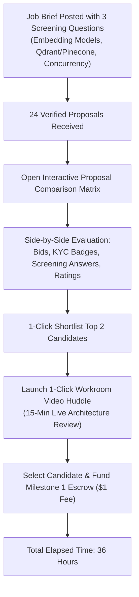
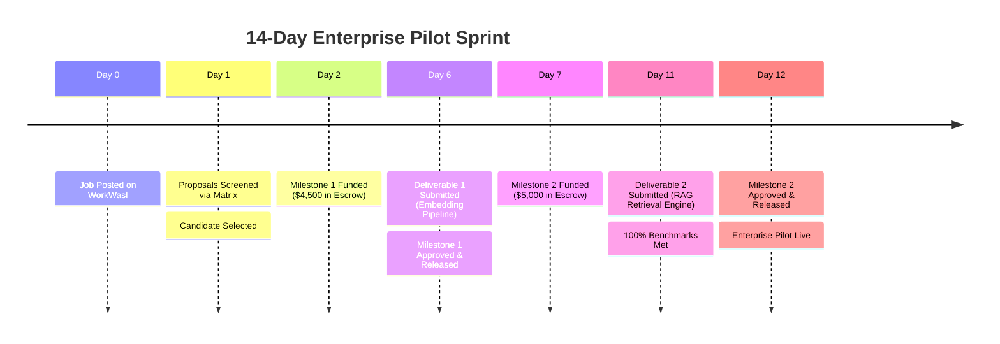

# Case Study 05: Rapid Engineering Sourcing via Proposal Comparison Matrix

## Executive Summary

| Sourcing Dimension | Traditional Marketplaces (Upwork / Freelancer) | WorkWasl Accelerated Pipeline |
| :--- | :--- | :--- |
| **Time to First Qualified Hire** | 10 to 14 business days | **36 hours from listing to contract funding** |
| **Proposal Screening Method** | Manual scrolling through 60+ unstructured text bids | **Interactive Side-by-Side Comparison Matrix** |
| **Bot & Spam Mitigation** | Minimal; spam proposals flood open jobs | **Mandatory structured screening questions & KYC checks** |
| **Time-to-Interview** | 3 to 5 days coordinating external Zoom links | **1-click instant Workroom Video Huddle inside platform** |
| **Contract Onboarding Cost** | 3%–5% client processing + 10% talent fee | **Flat $1.00 client fee + $1.00 talent fee** |

---

## The Company & Urgent Sourcing Bottleneck

**Organization:** DocuMind AI (Series Seed AI SaaS, New York, NY)  
**Requirement:** Senior Python & Vector Search Optimization Engineer  
**Timeline Constraint:** Hard 14-day deadline to deliver high-throughput Retrieval-Augmented Generation (RAG) pipeline for an enterprise Fortune 500 customer pilot.

### The Problem with Traditional Marketplaces
When DocuMind initially attempted sourcing on legacy freelance platforms:
1. **The AI Proposal Flood:** Within 4 hours of posting, the job received 58 generic, ChatGPT-generated cover letters with exaggerated claims and identical buzzwords.
2. **Scattered Evaluation Workflow:** The hiring manager had to manually click open 58 separate tabs, attempt to locate actual benchmark experience, and maintain a separate spreadsheet to track candidate bid amounts and answers.
3. **Delayed Technical Screening:** Scheduling initial video calls required exchanging Calendly links, losing 3 to 4 business days before technical evaluations even began.

---

## The WorkWasl Solution: The Proposal Comparison Matrix

DocuMind migrated the sourcing process to **WorkWasl** and leveraged three purpose-built hiring tools:

### 1. Mandatory Structured Screening Questions
During proposal submission ([`src/components/forms/apply-job-form.tsx`](file:///d:/mywork/xcs-job-portal/src/components/forms/apply-job-form.tsx)), applicants were required to answer 3 targeted technical questions:
1. *"What vector similarity metric and indexing strategy (HNSW vs IVFFlat) would you use for 5M financial documents?"*
2. *"How do you handle rate-limit backoff across OpenAI text-embedding-3-large batches?"*
3. *"Provide a link to a public repository or pull request demonstrating your vector search experience."*

### 2. The Interactive Proposal Comparison Matrix
Inside [`src/components/proposals/proposal-comparison-matrix.tsx`](file:///d:/mywork/xcs-job-portal/src/components/proposals/proposal-comparison-matrix.tsx), DocuMind's hiring manager evaluated candidates side-by-side in a responsive comparative grid:

- **Direct Rate & Timeline Comparison:** Side-by-side visibility of proposed milestones, total bid, and estimated days.
- **Verification Badges:** Instant visual confirmation of payment verification, identity verification, and completed contract counts.
- **Answer Alignment:** Technical answers to the 3 questions displayed in synchronized comparison rows.
- **1-Click Shortlisting:** Shortlisted the top 2 candidates in seconds.

### 3. Frictionless In-Platform Workroom Huddle
- Rather than waiting days for external calendar invites, DocuMind clicked **"Workroom Huddle"** directly from the shortlisted proposal workroom.
- Conducted a 15-minute encrypted WebRTC screen-share session with the top candidate to inspect previous vector benchmarking code.
- Awarded the contract immediately following the call.

---

## The Two-Milestone Sprint Execution

### Milestone 1: Vectorization & Batch Ingestion ($4,500.00)
- *Scope:* Automated PDF parsing, semantic chunking, and batch embedding generation into Qdrant.
- *Timeline:* Delivered in 4 calendar days (3 days ahead of schedule).
- *Review:* Approved and released within 3 hours of submission.

### Milestone 2: Hybrid RAG Search & Cache Optimization ($5,000.00)
- *Scope:* BM25 keyword + vector semantic hybrid retrieval, Redis caching layer, and sub-120ms latency benchmark under concurrent load.
- *Timeline:* Delivered in 5 calendar days.
- *Review:* Pilot criteria met; final milestone released.

---

## Measurable Results & Hiring Metrics

| Performance Indicator | Industry Average (Tech Hiring) | DocuMind on WorkWasl |
| :--- | :--- | :--- |
| **Sourcing-to-Contract Duration** | 14 calendar days | **36 hours (89% acceleration)** |
| **Hiring Manager Time Spent Screening** | 8.5 hours | **45 minutes via Comparison Matrix** |
| **Platform Commission Saved** | $950.00 to $1,425.00 | **Paid only $2.00 total platform fee** |
| **Pilot Delivery Deadline** | Target: 14 days | **Completed in 11 days (3 days ahead)** |
| **Reciprocal Feedback** | N/A | **5.0 Stars & verified public case study** |

---

## Client Testimonial

> *"In the AI startup ecosystem, speed is existential. Traditional freelance platforms drowned us in automated bot spam that took days to filter. WorkWasl's Proposal Comparison Matrix allowed us to evaluate technical answers side-by-side, hop into a WebRTC video huddle within minutes, and execute a fully funded milestone contract in under 36 hours. The engineer delivered ahead of schedule, and we won the enterprise pilot."*  
> — **Head of AI Engineering, DocuMind**
