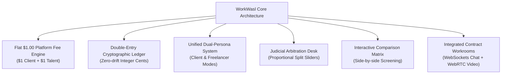

# WorkWasl Case Studies & Platform Use Cases

Welcome to the **WorkWasl Case Studies and Use Cases Library**. This section documents real-world operational models, technical workflows, and measurable business outcomes enabled by WorkWasl's high-trust freelance talent platform.

---

## Library Index

| Document | Focus Area | Key Actors | Core Outcome / ROI |
| :--- | :--- | :--- | :--- |
| [01. Platform Use Cases Catalogue](./01-platform-use-cases.md) | Exhaustive catalogue of 15 functional use cases | Clients, Freelancers, Teams, Admins | End-to-end mapping of all platform workflows, state machines, and ledger mutations. |
| [02. Enterprise FinTech Migration](./02-fintech-escrow-migration.md) | High-ticket API engineering ($45,000 contract) | Vanguard Digital Labs & Distributed Systems Architect | **$6,748.00 saved** in platform commissions; 100% auditable double-entry escrow ledger. |
| [03. Dual-Persona Boutique Agency](./03-dual-persona-agency-scaling.md) | Hybrid hiring and subcontracting operations | PixelCraft Labs (Design Studio) & Enterprise Client | Seamless switching between hiring and earning under one account; **$2,198.00 retained margin**. |
| [04. Judicial Dispute Arbitration](./04-arbitration-and-dispute-resolution.md) | Staged milestone scope dispute & mediation | CartFlow Technologies & Backend Go Engineer | Granular **70/30 proportional split ruling** executed atomically; zero chargebacks or account lockouts. |
| [05. Rapid AI SaaS Engineering Sourcing](./05-ai-saas-rapid-hiring-pipeline.md) | Urgent 14-day enterprise pilot delivery | DocuMind AI & Vector Search Specialist | **36-hour sourcing-to-contract cycle** via Proposal Comparison Matrix & in-workroom WebRTC video huddle. |

---

## Architectural Pillars Tested Across All Case Studies

---

## The Economics: WorkWasl Flat $1.00 vs. Legacy Marketplaces

WorkWasl replaces extractive percentage commission structures with an open, utility-priced model:

$$\text{WorkWasl Platform Cost} = \$1.00_{\text{Client (at funding)}} + \$1.00_{\text{Talent (at payout)}} = \$2.00 \text{ Total per Contract}$$

### Comparative Fee Impact Across Contract Sizes

| Contract Value | Legacy Client Fee (5%) | Legacy Talent Fee (10%–20%) | Total Legacy Intermediary Fee | WorkWasl Total Fee | Net Capital Kept in Production |
| :--- | :--- | :--- | :--- | :--- | :--- |
| **$1,000.00** | $50.00 | $150.00 | $200.00 (20%) | **$2.00** (0.2%) | **+$198.00 (99.0% savings)** |
| **$5,000.00** | $250.00 | $750.00 | $1,000.00 (20%) | **$2.00** (0.04%) | **+$998.00 (99.8% savings)** |
| **$15,000.00** | $750.00 | $1,500.00 | $2,250.00 (15%) | **$2.00** (0.013%) | **+$2,248.00 (99.9% savings)** |
| **$45,000.00** | $2,250.00 | $4,500.00 | $6,750.00 (15%) | **$2.00** (0.004%) | **+$6,748.00 (99.97% savings)** |

---

## Getting Started

To explore specific technical and operational workflows, select any of the deep-dive guides above. For core platform implementation details and architecture, refer to the [Root Documentation Index](../README.md).
